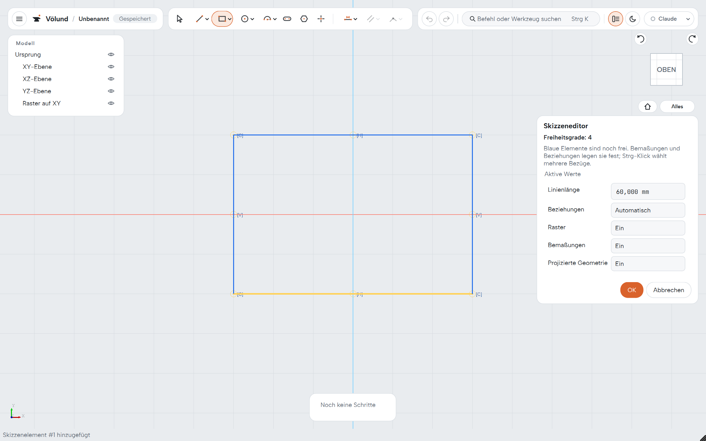
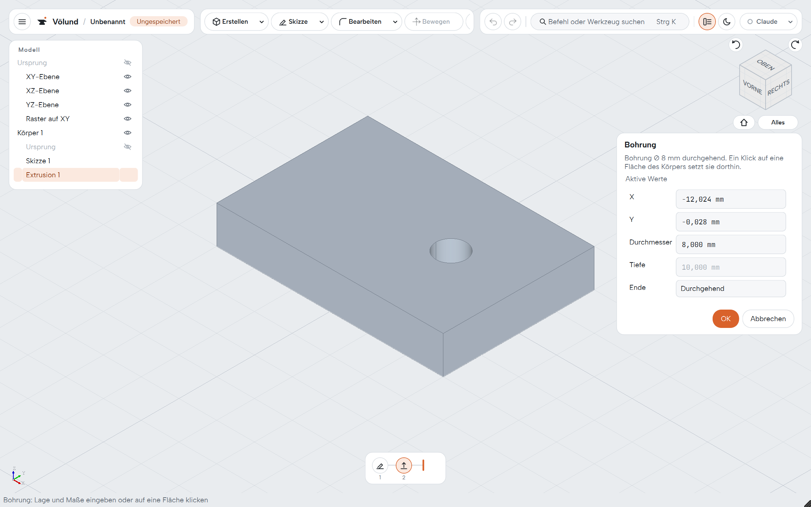
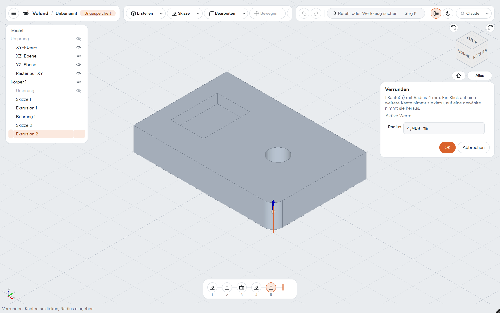
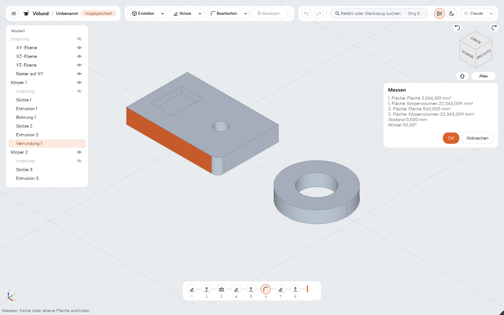
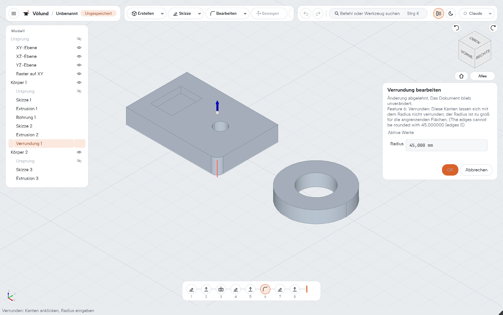
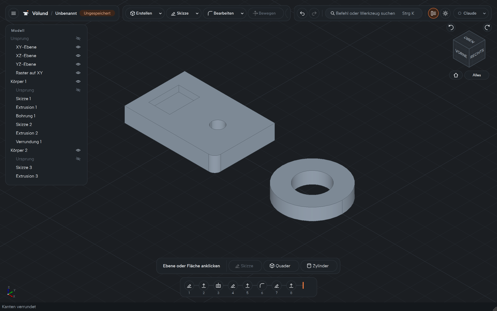

# Völund CAD

**A native parametric CAD application for mechanical parts – C++20, Qt 6 and OpenCASCADE,
Wayland-first, no Python, no web view.**


Völund builds solids from sketches and features, keeps the whole history editable, and saves it
in native OCAF documents. Everything in the screenshots on this page was built by a program that
drives the real product shell with clicks and typed values – the same way the acceptance tests do
([`ShowcaseCapture.cpp`](tests/desktop/ShowcaseCapture.cpp)).

The user interface is German; the code and its documentation are in English and German.

## What it does today

| | |
|---|---|
|  | **Sketches with a real solver.** Lines, polylines, rectangles, polygons, circles, arcs, ellipses, slots, points and B-splines on base planes, construction planes or body faces. Relations and dimensions are solved by PlaneGCS; free geometry stays blue until it is fully determined. Trim, extend, split, offset, mirror, patterns, sketch fillet and chamfer. |
|  | **Features with live preview.** Extrude (new body, join, cut, intersect, symmetric, up to a face), push/pull, revolve and groove, sweep, loft, helix, holes, shell, draft, mirror, linear and circular patterns, primitives, combine and move. Every tool opens one panel; OK is one undo step, Cancel leaves the document untouched. |
|  | **Fillets and chamfers on named edges.** Edges are picked in the view, Ctrl adds more, a grip drags the radius. Edges are named by their adjacent faces, so the fillet survives when earlier features change. |
|  | **Measuring without changing anything.** Two clicks give length, radius, area, volume, distance and angle; values copy at full precision. |
|  | **Errors are explained, never hidden.** An impossible change keeps the panel open, marks the cause in red and says why. A change that only breaks later features can be kept on purpose; nothing is ever deleted silently. |
|  | **A history you can work with.** The timeline at the bottom reopens any step, suppresses it, rolls the model back to it (drag the marker), reorders steps by dragging and deletes with a list of what depends on them. Light and dark themes, command search (Ctrl+K), autosave and crash recovery. |

**Exchange:** STEP import and export (File menu, Ctrl+I / Ctrl+E) with units and product names;
imported solids are embedded in the document and stay editable. IGES, STL and 3MF export; DXF
export of a sketch and DXF import into a sketch. **Assistant:** optional Claude access over MCP,
working through the same commands as the user.

The complete list of implemented variants and their limits is in the
[handbook (German)](docs/handbuch.md). New users start with the
[tutorial "Referenzplatte" (German)](docs/tutorial-referenzplatte.md): a plate with a hole, a
pocket and a rounded edge in about 15 minutes, every step of it replayed by a UI test.

## The DNA

What Völund is built on – the rules every change has to follow
([architecture and code contract](docs/architecture-and-code-contract.md), [ADRs](docs/adr/)):

- **Native all the way down.** C++20, Qt 6 Widgets, OpenCASCADE for geometry, OCAF for documents.
  No Python, no Electron or web view, no FreeCAD at runtime – FreeCAD is only a reference and
  test oracle.
- **Wayland first.** A native Wayland client on Linux and FreeBSD (Meridian); Qt owns the window
  and the OpenGL context, OCCT renders into it ([ADR 0001](docs/adr/0001-wayland-first-linux-viewport.md),
  [ADR 0006](docs/adr/0006-qt-owned-opengl-viewport.md)). Windows is a full development and test
  platform.
- **Stable names instead of indices.** Faces and edges are named by where they came from (a sketch
  element, a primitive role, a fillet's edge), never by a traversal index, so later features find
  them again after earlier ones change ([subshape reference contract](docs/subshape-reference-contract.md)).
- **One transaction per user intent.** Every command runs as one document transaction with one
  undo step; previews never touch the document ([command transaction contract](docs/command-transaction-contract.md)).
- **Explicit over clever.** No guessed repairs, no silent deletion, no automatic re-mapping of
  references: when something breaks, Völund shows where and lets the user decide.
- **One application core for every caller.** The shell, the tests and the Claude assistant use
  the same targeted actions ([ADR 0010](docs/adr/0010-native-actions-and-analysis-extension.md)).
- **Tested through the real product.** End-to-end tests click the real buttons, type into the real
  fields and use the real file dialogs on a virtual Wayland desktop in CI; every source file stays
  under 600 lines.
- **Planned in the open.** Work runs in bounded packages with acceptance scenarios and evidence
  ([plan](docs/implementation-plan/README.md), [`packets.json`](docs/implementation-plan/packets.json)).

## Status

Version `0.1.0`, not yet released. The mechanical v1 scope (gate G3) is complete; see the
[G3 report](docs/implementation-plan/evidence/G3.md).
Next come the remaining quality checks (cyclomatic complexity, static analysis) and the release packages (installer matrix, platform
acceptance on FreeBSD/Meridian). The current hand-off state is in
[`docs/development-status.md`](docs/development-status.md).

## Versions and changes

Changes are collected under `Unreleased` in the [Changelog](CHANGELOG.md).
[Versioning and release rules](docs/versioning.md) distinguish product releases, Git revisions
and document formats. New saves use BinOcaf container version 12 with native application schema
35; all earlier schemas and the legacy text formats VOLUND 1–16 remain readable.

The approved dependency budget and the distinction between build-time and shipped components are
recorded in [`docs/dependencies.md`](docs/dependencies.md).

The earlier FreeCAD/Python feasibility work is frozen under
[`spikes/phase-0-freecad/`](spikes/phase-0-freecad/). It is not part of the product build.

## Licence

Völund CAD is free software under the GNU General Public License, version 3 or any later
version (GPL-3.0-or-later), without any warranty; see [LICENSE](LICENSE). The components it
uses and ships keep their own licences, listed in [docs/dependencies.md](docs/dependencies.md)
and, in every package, in `THIRD-PARTY-NOTICES.md`.

## Prerequisites

- Windows: Visual Studio with the Desktop development with C++ workload
- FreeBSD desktop: Clang and Qt 6 with native Wayland integration; the project builds
  its pinned, Xlib-free OCCT 7.9.3 profile locally
- Linux core compatibility: GCC or Clang
- Git

CMake, Ninja, Qt, and OCCT are resolved by the project setup. No Python runtime is used.

## Configure, build, and test

On Windows, run from a Developer PowerShell:

```powershell
./tools/setup-windows.ps1
cmake --build --preset windows-msvc
./tools/test-windows.ps1
```

The test starter verifies the ASCII mapping and invokes CTest in the same execution
context. It also works across separate agent tool calls and rejects empty test filters.
For an existing build, use `-BuildDirectory build/<name>`; optional `-Label`,
`-TestRegex` and `-ReportPath` select tests and capture JUnit output. A fresh configure
directory can be requested with `setup-windows.ps1 -BuildName <name>`.

The Qt-owned OpenGL context backend is the Windows product default. The separate
native viewport is a diagnostic path:

```powershell
./tools/setup-windows.ps1 -Preset windows-msvc-native-diagnostic
cmake --build --preset windows-msvc-native-diagnostic
./tools/test-windows.ps1 -BuildDirectory build/windows-msvc-native-diagnostic
```

On FreeBSD:

```sh
sh ./tools/setup-freebsd.sh
sh ./tools/build-freebsd-occt.sh
cmake --preset freebsd-clang-lean-occt
cmake --build --preset freebsd-clang-lean-occt
ctest --preset freebsd-clang-lean-occt
```

Run the Wayland-labelled desktop gate from an active Wayland session:

```sh
ctest --preset freebsd-clang-lean-occt -L wayland
```

See [`docs/freebsd-meridian.md`](docs/freebsd-meridian.md) for the two-stage
control-desktop and Meridian validation procedure.

On Linux (reference: Fedora), the native Wayland desktop build uses system Qt 6,
Boost and Eigen plus the same project-local OCCT 7.9.3 as FreeBSD:

```bash
./tools/setup-linux.sh            # checks packages, builds lean OCCT, configures linux-desktop
cmake --build --preset linux-desktop
sh ./tools/run-linux-desktop.sh   # inside the Wayland session: full CTest, DISPLAY unset
```

`./tools/setup-linux.sh core` keeps the vcpkg-based `linux-gcc` core build without
the desktop target. Packet P05 accepts the Linux desktop path. Product desktop targets
are native Wayland on Linux and on FreeBSD under Meridian. X11 and
XWayland do not satisfy its viewport acceptance gate. Desktop enablement is validated
first on a mature FreeBSD Wayland desktop as a control and then under Meridian.

Local dependency builds are stored below `.tools/` and are intentionally excluded from version control.

## Install and start

`voelund-cad` is the only application. `main()` and the UI flow tests start the same shell
through one composition root (`voelund::desktop::startProduct`, see
[desktop-shell.md](docs/desktop-shell.md)).

```sh
cmake --install build/<preset> --prefix <directory>
<directory>/bin/voelund-cad [file.volund]
```

The installation carries the runtime the tests use: on Windows the Qt, OpenCASCADE and
FreeType libraries and the Qt platform plugin beside the executable; on Linux the
project-local OpenCASCADE libraries in the library directory (found through
`$ORIGIN`), Qt from the system, plus the desktop file and MIME type. The test
`desktop.installed_product` installs into an empty directory and starts the installed
executable. A document given on the command line opens like a double-clicked file;
`--mcp` switches the Claude access on.

## Viewport controls

- move the pointer over the body to preselect faces; left click selects a face, a base
  plane, a sketch region or an element;
- drag with the middle mouse button to pan, with the right mouse button to orbit; the
  mouse wheel zooms; the view cube switches to standard views;
- select a base plane or planar face and choose Sketch in the context bar; draw with the
  sketch tools, set values in the panel and finish with OK (Ctrl+Enter);
- select a closed sketch region and choose Extrude; the panel previews the body;
- in a sketch, a box from left to right selects elements inside it, from right to left
  everything it touches; Escape steps back (drag, preview points, tool, selection) and
  never discards the sketch.

The rules of the shell and the sketch editor are described in
[ui-concept.md](docs/ui-concept.md).

## Product structure

```text
apps/                executable composition roots
include/voelund/     public module interfaces
src/kernel/          OCCT geometry and topology boundary
src/document/        document, transactions, persistence, migration
src/features/        parametric feature graph
src/application/     commands and use cases
src/workspaces/      workspace and command contracts
src/modules/         independently registered product workspaces
src/viewport/        AIS/V3d scene and interaction
src/desktop/         Qt Widgets shell
src/platform/        operating-system adapters
packaging/           desktop, MIME, and platform package metadata
tests/               unit, integration, regression, differential
tools/               project-owned build and quality tooling
docs/                architecture, ADRs, and provenance
spikes/              frozen feasibility evidence outside the product build
```
