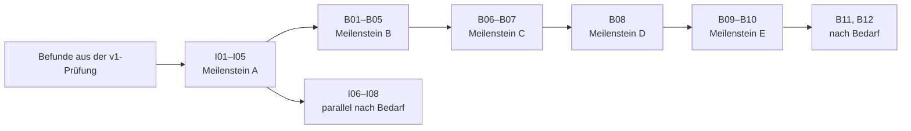

# 14 – STEP bearbeiten und Baugruppen wie in Fusion (Reihen I und B)

**Stand:** 30.10.2026, vom Nutzer freigegeben. Status steht in `packets.json`.

**Auftrag des Nutzers (30.10.2026):** Nach v1 sind zwei Punkte unverzichtbar:

1. STEP-Dateien einfach importieren und danach bearbeiten und ändern.
2. Baugruppen, die genauso einfach sind wie in Fusion.

Befunde aus der Prüfung von v1 gehen allen Paketen dieses Kapitels vor. Dieses Kapitel ersetzt
X01–X03 aus [Kapitel 07](07-produktbreite.md): Dort waren getrennte Teil- und
Baugruppendokumente vorgesehen, Fusion arbeitet anders (Entscheidung B-E1).

## Ausgangslage im Code

| Thema | Stand | Folge |
|---|---|---|
| STEP lesen | `readStep` liest über XDE, heilt ungültige Solids einmal, übernimmt Namen und Farbe je Solid | Grundlage steht |
| Baugruppenstruktur | `Collector::product` geht den Baum durch und wirft ihn weg; gleiche Teile werden unabhängige Kopien | für Baugruppen-Import ausbauen |
| Flächenmodelle | Schalen und Flächen werden nur gezählt, nicht übernommen | Vernähen fehlt |
| Direktbearbeitung | Flächen versetzen und löschen (N13a) über OCCT Offset und Defeaturing, als Zeitleistenschritt | Kern vorhanden |
| Flächenauswahl | `PlanarFaceSelection`: nur ebene Flächen anklickbar | **größte Lücke:** Bohrungen und Verrundungen sind gekrümmt |
| Importkanten | Laut M17 keine eigenen Namen, Projizieren und Achsen darauf gehen nicht | in I01 prüfen, dann schließen |
| Datei hineinziehen | gibt es nicht | ergänzen |
| Tests auf Importkörpern | Verrunden ist getestet; Bewegen, Flächen und Drücken/Ziehen nicht | I01 |
| Komponenten | gibt es nicht; eine globale Feature-Liste, keine Platzierung auf Körperebene | B-Reihe |
| Auswahl | hängt an `BodyId` (243 Stellen in 88 Dateien); ein Körper ist genau eine Darstellung | **größtes Baugruppen-Risiko** |
| Kollision, Messen, Masse | `findInterferences`, `measureBetween`, `MassProperties` | wiederverwendbar |

## Zielbild

- **STEP:** Datei ins Fenster ziehen. Jede Fläche anklicken, ziehen oder Wert tippen. Eine Bohrung
  zeigt ihren Durchmesser, eine Verrundung ihren Radius. Jede Änderung ist ein normaler
  Zeitleistenschritt, später änderbar und an Parameter bindbar.
- **Baugruppe:** Komponente anlegen oder Körper zu Komponenten machen, **J** drücken, Punkt an Teil
  A klicken, Punkt an Teil B klicken, Gelenkart wählen, OK. Das Teil springt an seinen Platz und
  lässt sich mit der Maus bewegen.

## Reihe I – STEP importieren und bearbeiten

### Entscheidungen

- **I-E1 – Bearbeiten heißt Zeitleistenschritte auf dem Import.** Das erfüllt ADR 0012 („keine
  direkte Modellierung ohne Historie“). Es gibt keinen eigenen Direktmodus.
- **I-E2 – Keine Rückgewinnung einer ganzen Feature-Historie aus STEP.** Das ist bei fremden
  Teilen unzuverlässig. Stattdessen wird beim Anklicken erkannt, was die Fläche ist (I05).
- **I-E3 – Abnahme an echten Dateien.** Die sieben NIST-Dateien aus Q01 und echte Teile des
  Nutzers bilden den Prüfbestand. Was OCCT nicht schafft, wird mit Begründung abgelehnt und lässt
  das Modell unverändert.

### Pakete

| Paket | Inhalt | Größe |
|---|---|---|
| I01 | **Bestandsprüfung:** alle vorhandenen Werkzeuge auf allen Prüfdateien automatisch laufen lassen; Ergebnisliste legt die Korrekturen fest | S |
| I02 | **Einfacher Import:** Drag & Drop, Fortschritt und Abbrechen bei großen Dateien, Ergebniskarte (was kam an, was nicht und warum), Farben je Fläche | M |
| I03 | **Flächenmodelle retten:** offene Schalen vernähen und zu Solids schließen, sonst klare Meldung | S |
| I04 | **Jede Fläche und Kante wählbar:** allgemeine Flächenauswahl statt `PlanarFaceSelection`; Werkzeuge, die eine Ebene brauchen, bleiben gesperrt; Kantennamen auf Importkörpern, Projizieren und Achsen darauf | M |
| I05 | **Ziehen wie in Shapr3D und Fusion:** Taste **Q** auf jeder Fläche, Pfeil und Wert. Ebene: versetzen. Bohrung: Durchmesser. Verrundung und Fase: neuer Radius oder Abstand (entfernen und neu anlegen) | L |
| I06 | **Ganze Formen wählen:** Klick auf Bohrung, Tasche oder Absatz wählt alle ihre Flächen. Löschen in einem Schritt. Gekrümmte Flächen löschen | M |
| I07 | **Fläche verschieben und drehen:** Griff wie beim Bewegen, auch für ganze Formen. OCCT bietet das nicht direkt, deshalb zuerst ein Spike. Grenzen werden im Nachweis festgehalten | L, riskant |
| I08 | **Import aktualisieren:** neue Fassung der Datei einlesen. Passt eine Referenz nicht mehr, wird sie als kaputt gezeigt und nicht geraten (ADR 0009) | M, später |

**Meilenstein A – fremdes Teil ändern (I01–I05):** Ein Lieferantenteil wird hineingezogen. Eine
Bohrung bekommt einen anderen Durchmesser, eine Fläche wird versetzt, eine Verrundung geändert,
eine Skizze auf einer Fläche ausgeschnitten. Nach Speichern und Öffnen stimmt alles, auch ohne die
STEP-Datei, und jeder Wert bleibt in der Zeitleiste änderbar.

## Reihe B – Baugruppen

### Entscheidungen

- **B-E1 – Eine Datei mit Komponenten, wie in Fusion.** Ein Dokument enthält eine Wurzelkomponente
  mit Unterkomponenten. So entstehen Teile und Baugruppe im selben Fenster, ohne Dateiwechsel.
  Bestehende Dateien bestehen nur aus der Wurzel und bleiben unverändert.
- **B-E2 – Eine Zeitleiste bleibt, wie in Fusion.** Jedes Feature gehört einer Komponente.
  `FeatureGraph` rechnet weiter in deren lokalen Koordinaten; die Geometrie kennt ihre Einbauorte
  nicht.
- **B-E3 – Eine Schicht über der Geometrie.** Eine **Instanz** ist Komponente plus Platzierung. Ein
  neuer Baustein liefert aus Dokument und Instanzen die Liste der platzierten Körper. Anzeige,
  Auswahl, Messen, Schnitt, Kollision und Export nutzen nur noch diese Liste. Bei einem Dokument
  ohne Komponenten ist sie identisch mit heute, das sichern die vorhandenen Tests ab.
- **B-E4 – Platzierungen und Gelenke stehen nicht in der Zeitleiste** (bewusste Abweichung von
  Fusion). Sie stehen als „Gelenke“ im Modellbaum, lassen sich dort bearbeiten und rückgängig
  machen. Damit entfällt „Position erfassen“, die in Fusion oft verwirrt: Ein Teil zu verschieben
  ist einfach ein Rückgängig-Schritt, und Zurückrollen oder Umordnen müssen keine Gelenke kennen.
- **B-E5 – Bewegen unterscheidet sich nach Auswahl.** Eine ganze Komponente bewegen ändert die
  Platzierung, einen Körper innerhalb einer Komponente bewegen bleibt der Bewegen-Schritt (M11).
- **B-E6 – Gelenkrechnung ohne neue Bibliothek.** Offene Ketten werden direkt ausgerechnet, ohne
  Solver und ohne Sprünge. Geschlossene Schleifen kommen später mit einem eigenen numerischen
  Löser; PlaneGCS ist nur 2D. Widersprüche werden am Gelenk gemeldet, andere Teile bleiben stehen.
- **B-E7 – Bedienung ohne Moduswechsel.** Eine neue Gruppe „Baugruppe“ in der Werkzeugleiste, eine
  Karte für das Gelenk, Felder am Viewport. Die erste Komponente ist automatisch fixiert.
- **B-E8 – Referenzen zwischen Komponenten zuerst abgelehnt.** Ein Feature in Komponente A darf
  anfangs nicht auf Geometrie von B zugreifen, sondern bekommt eine klare Meldung. Die assoziative
  Konstruktion im Kontext (B11) ist erst sinnvoll, wenn der Rest trägt, und braucht eine eigene
  Regel, weil Platzierungen nicht in der Zeitleiste stehen.

### Pakete

| Paket | Inhalt | Größe |
|---|---|---|
| B01 | **Vertrag:** ADR zu B-E1–B-E8, Schema, Header, Referenzbaugruppe (Grundplatte, zwei gleiche Bolzen, bewegliche Lasche), Spike Instanzdarstellung in OCCT | M |
| B02 | **Komponenten im Dokument:** anlegen, umbenennen, aktivieren (neue Features landen dort), „Komponenten aus Körpern“, Modellbaum, Speichern und Öffnen; noch eine Instanz je Komponente | L |
| B03 | **Platzierte Körper:** Baustein aus B-E3; Anzeige, Auswahl über den Instanzpfad, Messen, Schnitt, Kollision, Masse, Export und MCP stellen um | L, größtes Risiko |
| B04 | **Mehrere Instanzen:** Kopieren und Einfügen ergibt eine verknüpfte Instanz, „als Neu einfügen“ eine unabhängige Kopie. Änderung an einer Instanz wirkt auf alle | M |
| B05 | **Teile platzieren:** Griff und Mauszug, Fixieren, Ein-/Ausblenden und Isolieren je Instanz | M |
| B06 | **Gelenke:** **J**, Fangpunkte beim Überfahren (Flächenmitte, Kantenmitte, Bohrungsmitte, Ecke), zwei Klicks, Arten Starr, Drehen, Schieben, Zylinder, Stift-Schlitz, Planar, Kugel; Versatz und Winkel; Vorführen im Panel | L |
| B07 | **Bewegen mit Gelenken:** Teil ziehen folgt den Freiheitsgraden der Kette, Grenzen je Gelenk, Gelenk „wie gebaut“, Fehlermeldungen am Gelenk | M |
| B08 | **STEP-Baugruppen:** Import als Komponenten und Instanzen mit dem Baum der Datei, gleiche Teile nur einmal gespeichert; Export mit Struktur; Importgrenzen neu prüfen | M |
| B09 | **Andere Dateien einfügen:** verknüpfte `.volund`-Datei, schreibgeschützt in der Baugruppe, Aktualisieren, fehlende Datei reparieren, Zyklen ablehnen, Verknüpfung lösen | L |
| B10 | **Stückliste:** Teile, Anzahl, Material, Masse; Ausgabe als CSV; Kollisionsprüfung über alle Instanzen | S |
| B11 | **Im Kontext konstruieren:** Skizze oder Feature in A nutzt Geometrie von B | L, später |
| B12 | **Geschlossene Schleifen:** numerischer Löser, Getriebe und Kopplungen nur, wenn der Nutzer sie braucht | L, später |

**Meilenstein B – Komponenten (B01–B05):** Mehrkörpermodell zu Komponenten gemacht, zwei Bolzen als
Instanzen eines Teils, Bolzen geändert, beide folgen.

**Meilenstein C – Mechanismus wie in Fusion (B06–B07):** Scharnier aus der Referenzbaugruppe mit
**J**, zwei Klicks und OK, mit der Maus drehbar, Grenzen greifen, Speichern und Öffnen behalten
alles.

**Meilenstein D – fremde Baugruppe (B08 und I-Reihe):** STEP-Baugruppe mit gleichen Teilen landet
als Baum im Modellbaum. Ein Teil wird geändert, alle Instanzen folgen, das Ergebnis geht als STEP
mit Struktur wieder hinaus.

**Meilenstein E – mehrere Dateien (B09–B10):** Baugruppe aus eigenen Dateien mit Stückliste.

## Befunde aus I01 (30.10.2026)

Details: [I01-Nachweis](evidence/I01.md).

- Der Linux-Build von OCCT stürzte mit `-O3` unter GCC 16 ab; er baut jetzt mit `-O2`.
- OCCTs Offset taugt nicht für echte Teile. I05 nutzt stattdessen `FaceReplacement` (Topologie bleibt,
  Kanten werden neu geschnitten). Dasselbe trägt I07.
- Die Druckerdatei (1667 Körper) lässt sich lesen und importieren, aber eine Änderung dauert 178 s
  und Rückgängig 104 s bei bis zu 8 GB Speicher. **Damit bekommt B03/B08 eine harte Messlatte:** Eine
  Änderung an einem Teil darf nicht mehr alle Körper neu auswerten, Rückgängig nicht das ganze
  Dokument wiederherstellen. Die Datei teilt fast keine Geometrie (1654 verschiedene Formen), Instanzen
  allein reichen also nicht; es braucht Auswertung je Komponente.

## Reihenfolge

- **STEP zuerst:** Das ist schneller nutzbar, hängt an nichts anderem, und die allgemeine
  Flächenauswahl (I04) brauchen auch die Gelenk-Fangpunkte.
- **B03 vor den Gelenken:** Erst wenn Auswahl und Anzeige den Instanzpfad kennen, lässt sich ein
  Gelenk sauber an eine bestimmte Instanz hängen.
- **B08 nach den Gelenken:** So lässt sich eine importierte Baugruppe sofort mit Gelenken bewegen.

## Risiken

| Risiko | Gegenmaßnahme |
|---|---|
| B03 berührt viele Stellen. Eine Vermischung von Weltkoordinaten und lokalen Koordinaten erzeugt stille Fehler | eigene Typen für Körper und platzierten Körper; alle bestehenden Tests müssen unverändert grün bleiben; Tests mit gedrehter Instanz für jedes Werkzeug |
| OCCT-Offset und Defeaturing scheitern an echten Geometrien | I01 misst das früh; ablehnen statt kaputtes Ergebnis; Grenzen stehen im Handbuch |
| Fläche verschieben (I07) ist nicht allgemein lösbar | Spike vor dem Zusagen, Umfang richtet sich nach dem Ergebnis |
| Flächennamen des Imports sind Nummern im gespeicherten Solid. Sie gelten nur, solange die Bytes gleich bleiben | I08 behandelt Referenzen nach dem Einlesen als kaputt, statt sie zu raten |
| Große Baugruppen sprengen die Dateigrenze (48 MiB BRep, 64 MiB Dokument) oder die Anzeige | gleiche Teile nur einmal speichern (B08), B01 misst die Instanzdarstellung, Grenzen in B08 neu festlegen |
| Schemaänderungen | B02 ist rein additiv, ältere Dateien lesen wie bisher; Dateien aus neuen Versionen werden von alten Versionen wie bisher abgelehnt |

## Nicht in diesem Kapitel

- Vollständige Feature-Erkennung aus STEP
- Bewegungsstudien, Kontaktsätze und Normteilkatalog
- Zeichnungen (X04) und Cloud-Verwaltung
- Parallele Bearbeitung einer Komponente durch mehrere Personen
