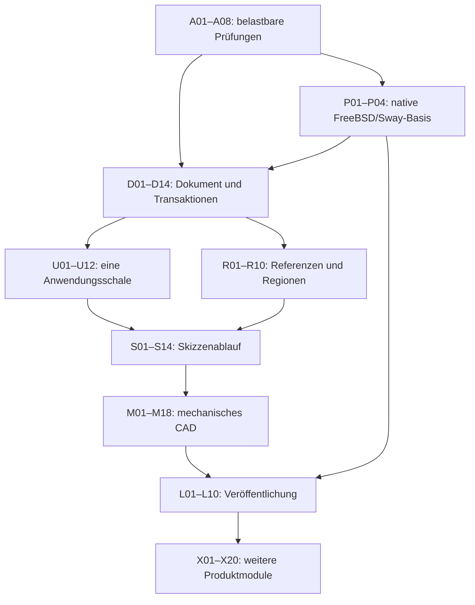

# Völund: vom vorhandenen Prototyp zum belastbaren CAD

**Pause am 13.09.2026:** [Fortsetzungsnotiz und Einstieg D07](../session-checkpoint-2026-09-13.md). Keine Hintergrundarbeit.

Planungsstand: **13. September 2026**, untersuchter Code: `1b78229`.
Status: **A01, A03, A05, A06, A07, A08, P01, P02 und P03 abgenommen; A02 braucht weitere Entwicklung. G0 bleibt offen.**
Aktueller Nachweis: [A06 – Kernel-Fehlergrenze mit Gegenprüfung](evidence/A06.md).
Die [A08-Smokes und optische Prüfung](evidence/A08.md) bleiben der bisherige Nachweis für beide Windows-Backends.
Aktueller Nachweis: [P03 – DPI, FBO und Renderstabilität](evidence/P03.md), 28/28 CTests im Qt-OpenGL-Produktweg und 24/24 im Native-Diagnoseweg. Skalierungen 100/150/200 Prozent, 150 Ressourcenzyklen und eigene Bildabnahme abgeschlossen. [P04](evidence/P04.md) ist als FreeBSD/Sway-Basis gemäß ADR 0007 abgenommen: 23/23 CTests, Lifecycle/Interaktion und betrachtete Compositoraufnahmen. [Hostdokumentation](../development-hosts.md). Meridian folgt in L07; A02/A04 bleiben offen.

Dieser Plan beantwortet die Frage, wie kleinere Modelle das Projekt kontrolliert weiterbauen können. Er ersetzt keinen bestehenden Architekturvertrag. Er macht dessen Anforderungen ausführbar und kennzeichnet neue Architekturentscheidungen als Vorschläge, die durch die vorgeschalteten Entscheidungspakete konkretisiert werden müssen.

## Ergebnis der Bestandsaufnahme

Völund besitzt einen brauchbaren nativen technischen Kern: OCCT-Geometrie, ein parametrisches Dokument, PlaneGCS, Skizzenwerkzeuge, Auswahl, Transformationen und eine funktionierende ältere Anwendungsschale. Die neuere Oberfläche zeigt bereits die gewünschte Gestaltung. Das ist eine verwendbare Ausgangsbasis; ein Neubau ist nicht begründet.

Der nächste Schritt sollte trotzdem **nicht einfach der nächste Ribbon-Befehl** sein. Zwei Oberflächen entwickeln unterschiedliche Fachlogik. Speichern überschreibt die bisherige Datei direkt. Die geforderte OCAF-Dokumentbasis fehlt. Referenzen auf Flächen und Kanten sind teilweise geometrische oder indexbasierte Näherungen. Die Profilerkennung erzeugt noch keine allgemeinen Flächen mit Löchern. Einige sichtbare Bedienelemente führen keine entsprechende Modelländerung aus.

Im Ausgangsaudit bestanden **16 von16 CTests**, einschließlich eines falsch grünen Dateigrößenchecks. A01 hat diese Fehlprüfung repariert; A03 beseitigt die vier Größenverstöße. Aktuell bestehen **28 von28 CTests im Qt-OpenGL-Produktweg und 24 von24 im Native-Diagnoseweg**, einschließlich der Langlochregression und der A08-Negativprüfungen. Die noch fehlenden Analyse- und Plattformnachweise halten G0 offen. Historische Details stehen in der [Bestandsaufnahme](01-bestandsaufnahme.md), aktuelle Ergebnisse im [P03-Nachweis](evidence/P03.md).

Die Untersuchung erlaubt keine belastbare Aussage, dass ein bestimmtes Modell das Projekt grundsätzlich nicht überblicken kann. Sie zeigt aber, dass Aufgaben, Vertragsdurchsetzung und Abnahme bislang zu viel Interpretation offenlassen. Auch das eigentliche Coden eines CAD-Systems bleibt anspruchsvoll: Topologie, numerische Toleranzen, Undo, Migration und OpenGL-Lebenszyklen sind keine bloßen Fleißaufgaben. Ein kleineres Modell kann klar begrenzte Pakete ausführen; schwierige Entwurfsentscheidungen und Gegenprüfung verschwinden dadurch nicht.

## Was „ins Ziel“ bedeutet

| Stufe | Nutzbares Ergebnis | Verbindliche Grenze |
|---|---|---|
| G0 – ehrliche Basis | Reproduzierbarer Build, aussagekräftige Prüfungen, FreeBSD/Sway-Basis | Meridian erst abschließend gemäß ADR 0007; Paketabhängigkeiten bleiben verbindlich |
| G1 – verlässliches Dokument | Atomare Speicherung, einzelne Undo-Transaktionen, explizite Fehlerzustände, OCAF-Entscheidung und getesteter Dokumentkern | Keine stillen Ersatzreferenzen oder still verlorenen Änderungen |
| G2 – zusammenhängendes CAD | Eine produktive Oberfläche; neues Dokument → Ebene → Skizze → echte Extrusion → Änderung → Speichern → Öffnen | Alle sichtbaren aktivierten Befehle funktionieren über denselben Anwendungskern |
| G3 – mechanisches CAD v1 | Mehrkörpermodell, robuste Profile/Referenzen, Extrude/Pocket, Fillet/Chamfer, Hole, Mirror/Pattern, Timeline, STEP, Maße | Definierter Funktionsumfang und veröffentlichte Grenzen; kein FreeCAD-Komplettheitsversprechen |
| G4 – veröffentlichbare v1 | Installierbares Paket auf Windows und FreeBSD/Meridian, Migration, Recovery, nachvollziehbare Herkunft und Abnahme | Build auf Entwicklerrechner allein genügt nicht |
| G5 – erweiterte Produktfamilie | Baugruppen, Zeichnungen, Surface, Mesh, Sheet Metal, Vault und Fertigungsanbindung | Jedes Modul erhält eigene Fachverträge, Fixtures und Freigabestufen |

**V1 ist der erste verlässliche mechanische Produktkern, nicht das Ende der Gesamtvision.** Die ursprüngliche Vision CAD/Vault/Manufacturing bleibt im [Ausbauplan](07-produktbreite.md) erhalten. Ein vollständiger FreeCAD-ähnlicher Umfang ist ein mehrstufiges Produktprogramm. Ein seriöser Plan kann unbekannte Vault-Schnittstellen oder Maschinenprofile nicht vorweg erfinden; dafür sind eigene, begrenzte Spezifikationsaufträge enthalten.

## Lesereihenfolge

1. [01 – Bestandsaufnahme und Nachweise](01-bestandsaufnahme.md): Was tatsächlich existiert und was fehlt.
2. [02 – Zielverträge](02-zielvertraege.md): Zuständigkeiten, Identitäten, Fehler, Transaktionen und Persistenz.
3. [03 – Fundament](03-fundament.md): Build, Prüfungen, sichere Speicherung, Dokument und Referenzen.
4. [04 – Oberfläche und Skizze](04-oberflaeche-skizze.md): Zusammenführung und vollständiger Skizzenablauf.
5. [05 – Körper, Historie und Austausch](05-solid-historie.md): Mechanischer Produktumfang in kleinen Paketen.
6. [06 – Plattform und Veröffentlichung](06-plattform-release.md): Meridian, Laufzeitpaket und Release-Abnahme.
7. [07 – Produktbreite](07-produktbreite.md): Baugruppen bis Fertigung; klare spätere Lieferstufen.
8. [08 – Abnahmekatalog](08-abnahme.md): Konkrete positive und negative Szenarien.
9. [09 – Arbeitsauftrag für Terra](09-terra-arbeitsauftrag.md): Direkt verwendbarer Ausführungsauftrag.
10. [10 – Selbstständige Umsetzung und optische Prüfung](10-autonome-umsetzung.md): Eigenständige Paketfolge, Testverantwortung und minimale Benutzerbeteiligung.
11. [Maschinenlesbare Paketliste](packets.json): IDs, Abhängigkeiten, Prüfpunkte und Status.

Nachweise: [Windows-Audit mit Reproduktionsbefehlen](evidence/windows-audit-20260913.md)
und [Inventar der 220 versionierten Ausgangsdateien](evidence/inventory.json).
Die Planprüfung hat alle 110 IDs, die vollständige topologische Reihenfolge,
Paketüberschriften, vorhandene Code-Einstiegspunkte, lokale Links und referenzierte
Abnahmeszenarien geprüft. Das bestätigt die Konsistenz des Plans, nicht die bereits
erfolgte Umsetzung seiner Pakete.

## Ausführungsregeln

- Ein Umsetzungsschritt bearbeitet **genau eine Paket-ID**. Bei beauftragter Gesamtumsetzung führt der Agent nach Abnahme selbstständig das nächste zulässige Paket aus; der Nutzer muss nicht jedes Paket einzeln anstoßen. Kleine Arbeitskontexte bleiben erhalten.
- Zuerst Pflichtlektüre und referenzierte Symbole lesen; dann einen kurzen lokalen Umsetzungsplan ableiten. Abhängigkeiten müssen nachgewiesen fertig sein.
- Jedes Paket definiert Verhalten, betroffene Bereiche, Prüfungen und Nicht-Ziele. Neue Dateien sind Vorschläge; vorhandene Konventionen haben Vorrang.
- Umfangsgrenze: grundsätzlich eine Verantwortlichkeit, höchstens fünf produktive Quelldateien zusätzlich zu zugehörigen Tests. Bei notwendiger Überschreitung vor Implementierung Unterpakete mit demselben Vertrag anlegen. Keine künstlichen 600-Zeilen-Aufteilungen ohne fachliche Grenze.
- Ein verhaltensändernder Fehlerfix braucht den passenden Regressionsfall. Tests prüfen beobachtbares Verhalten und Invarianten; sie schreiben nicht den Implementierungsalgorithmus ein zweites Mal nach.
- Architekturentscheidungen nicht beiläufig in Feature-Aufträgen treffen. Der Agent bearbeitet die Entscheidungspakete einschließlich Alternativen, Nachweisen und dokumentierter Gegenprüfung selbstständig innerhalb der vorhandenen Produkt-/Architekturvorgaben. Nur eine tatsächlich erforderliche, noch nicht autorisierte Abweichung oder nicht ableitbare Produktentscheidung benötigt den Nutzer; keine routinemäßige Bestätigung pro Entwurf oder Fix.
- Bestehende Benutzeränderungen erhalten. Kein Zurücksetzen des Arbeitsbaums, keine neuen Bibliotheken, keine neuen Produktmodule und kein Python als Nebenlösung.
- Ein Paket ist erst fertig, wenn die Paketabnahme bestanden, relevante bestehende Tests grün und Dokumentation/Status wahrheitsgemäß aktualisiert sind. Ein nicht verfügbarer Plattformtest bleibt ausdrücklich offen.
- Fertigmeldung enthält Änderung, verwendete Befehle, Resultate und verbleibende Grenzen. „Sollte funktionieren“ zählt nicht als Nachweis.
- Tests, UI-Bedienung, Screenshotaufnahme, optische Kontrolle, Plattformläufe und Statuspflege verantwortet der Agent im Rahmen verfügbarer Werkzeuge und Zugänge. Kapitel 10 legt Vorgehen und zulässige Ausnahmen fest; eine Benutzerprüfung ist der letzte notwendige Rest, kein Standardarbeitsschritt.

## Reihenfolge und kritischer Pfad

Der vollständige Abhängigkeitsgraph und eine gültige Ausführungsreihenfolge stehen in `packets.json` unter `topologicalOrder`. Es gibt **110 Hauptpakete: 90 bis zur veröffentlichbaren v1 und 20 für die ersten Lieferstufen der weiteren Produktmodule**. Die Kapitel sind thematisch geordnet; insbesondere P01–P04 laufen früh und U11 wartet auf einzelne S-Pakete. Bei widersprüchlichen Abhängigkeiten gilt: nicht raten, Manifest korrigieren und prüfen.

P01–P04 sichern die native FreeBSD/Sway-Basis. Nach ausdrücklicher Nutzerentscheidung in [ADR 0007](../adr/0007-sway-development-meridian-final.md) blockiert Meridian keine CAD-Erweiterungen mehr; die echte Meridian-Integration folgt abschließend in L07. Eigene Paketabhängigkeiten und Qualitätsprüfungen bleiben verbindlich.

Anschließend D-Pakete, R-Pakete und die Zusammenführung U-Pakete durchführen. Frühe Datenkorrektheit verhindert, dass neue Featuretypen und Oberflächen später doppelt umgebaut werden. Erst danach den Skizzenumfang abschließen und die mechanischen Werkzeuge ergänzen. Der abschließende Plattformdurchlauf ist nach den Architekturänderungen erneut nötig.

## Planung, Aufwand und Steuerung

Keine seriöse Kalenderzusage lässt sich aus Dateizahl oder Modellnamen ableiten. Die ersten acht Pakete liefern Messwerte: tatsächliche Bearbeitungszeit, Nacharbeit, Fehlerquote und Integrationsaufwand. Danach Termine pro Gate aus diesen Daten ableiten; für Geometrie, Migration und Plattformen eigene Risikoreserven planen.

Pro Gate öffnet, verändert und speichert der Agent ein Integrationsmodell und öffnet es auf dem verfügbaren Zielsystem wieder. Als Referenz dienen die Szenarien in Kapitel 08. Der Agent pflegt Paketstatus, Evidenz und Entwurfsentscheidungen selbst; der Nutzer muss weder Testkoordinator noch Paketverwalter sein. Die ausführenden Modelle brauchen nicht jedes Mal die gesamte Projektdokumentation im Kontext.

Die ausführbaren Pakete bis G4 sind detailliert. Für G5 werden erste vertikale Lieferstufen und deren Spezifikationspakete definiert; weitere Unterpakete entstehen erst aus nachgewiesenen Fachverträgen. Das ist eine bewusste Grenze zwischen einem ausführbaren Plan und Scheingenauigkeit.

Aktueller Fortschritt: [D01 – atomarer Dateiersatz](evidence/D01.md) abgenommen: Windows 29/29, FreeBSD/Sway 24/24. [D02](evidence/D02.md) ist ebenfalls abgenommen: Windows 30/30, FreeBSD/Sway 25/25; 16 Versionsfixtures und begrenzter Parser. [D03](evidence/D03.md) ist abgenommen: Windows 32/32, FreeBSD/Sway 27/27; atomarer Save/Open und produktive Dateimenü-Regressionen. [D04](evidence/D04.md) ist als Vertragsentscheidung abgenommen (je 5/5 gezielte Prüfungen). [D05](evidence/D05.md) ist abgenommen: Windows 35/35, FreeBSD/Sway 31/31 und zusätzlicher Windows-Release-Allokationslauf 2/2. [D06](evidence/D06.md) ist abgenommen: Windows 36/36, FreeBSD/Sway 32/32; ein Undo für die kombinierte Skizzenextrusion. D07 schließt als Nächstes die Resultat-/Fehlerbehandlung bis zur UI an.
