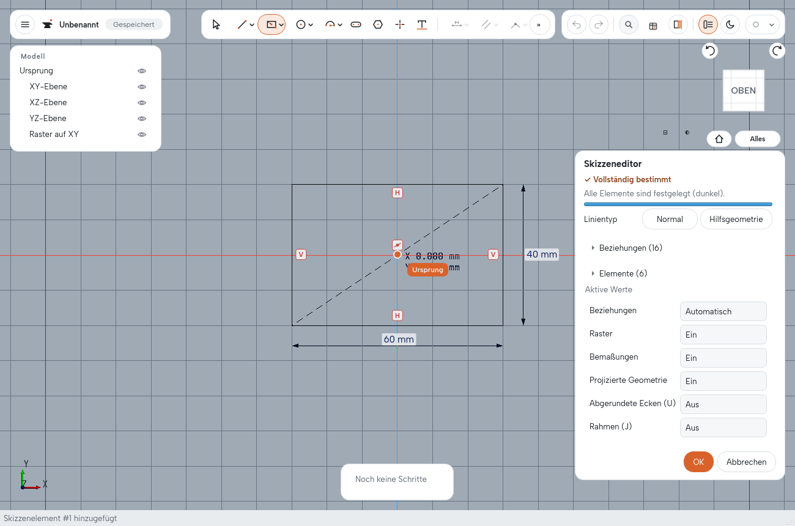
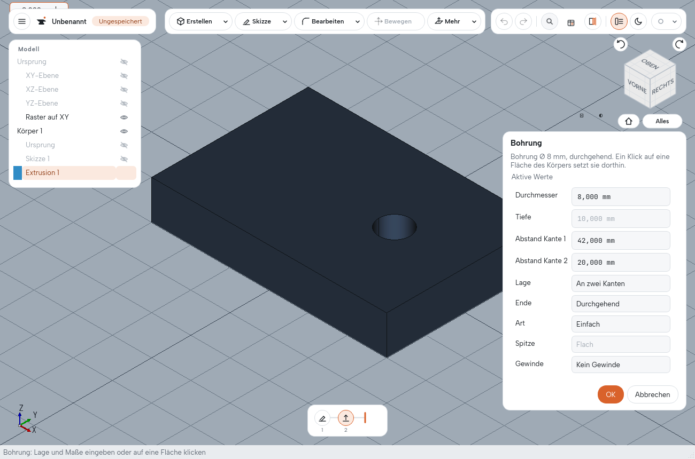
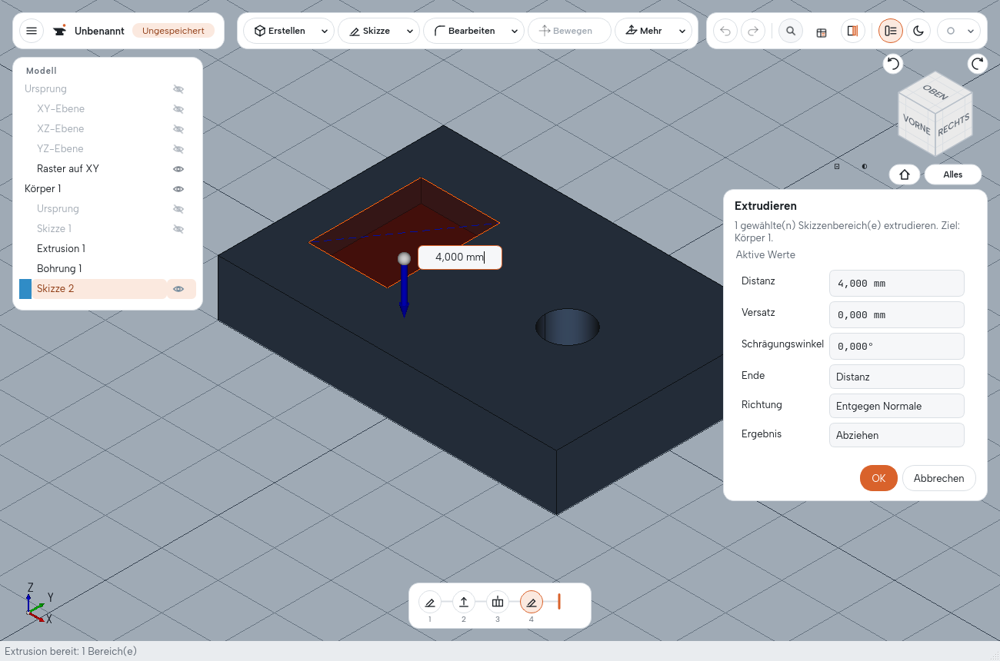
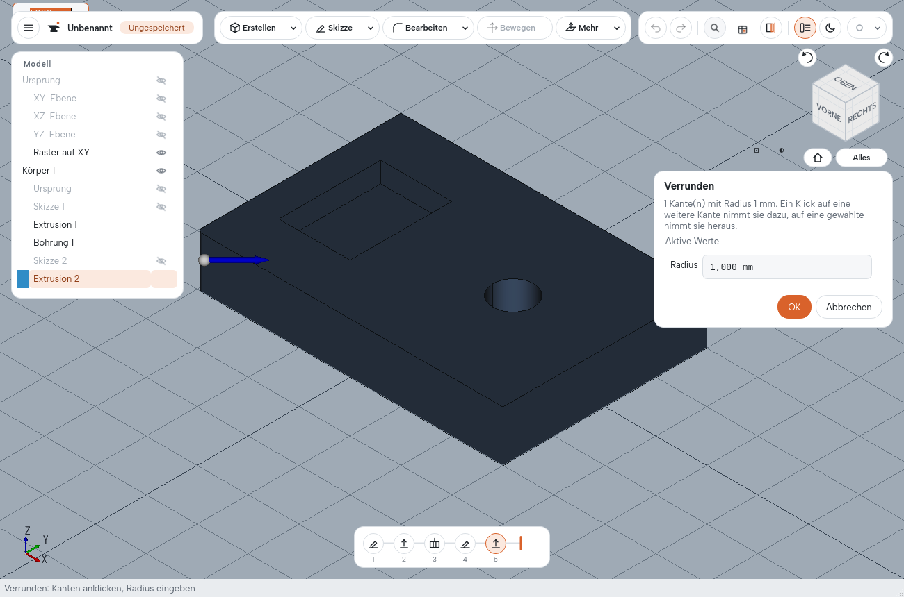
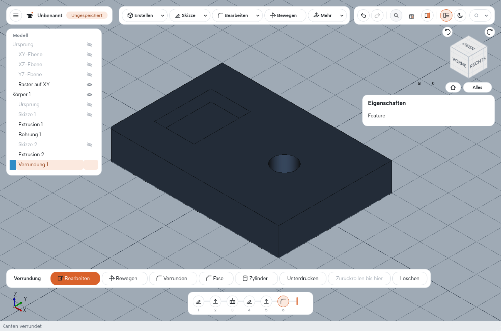

# Tutorial: Die Referenzplatte

In diesem Tutorial bauen Sie eine Platte mit Bohrung, Tasche und einer verrundeten Kante. Danach
ändern Sie Maße über die Timeline, speichern und tauschen das Teil als STEP aus. Es dauert etwa
15 Minuten.

Jeder Schritt hier ist genau so in einem automatischen Oberflächentest nachgespielt
(`desktop.tutorial_reference_plate`). Die Zahlen am Ende jedes Abschnitts sind die Volumen, die
dieser Test prüft. Mit **Messen** (Taste I) und einem Klick auf den Körper können Sie sie selbst
nachsehen.

Sie brauchen das installierte Völund CAD (siehe [Installation](../README.md)).

## 1. Die Grundplatte (60 × 40 × 10 mm)

1. Starten Sie Völund CAD. Ein neues, leeres Dokument ist offen (sonst **Strg+N**).
2. Klicken Sie in der Ansicht auf die waagerechte Grundebene **XY**. Die Statuszeile nennt „XY“,
   und am Mauszeiger erscheint die Kontextleiste.
3. Klicken Sie in der Kontextleiste auf **Skizze**. Die Ansicht dreht sich auf die Ebene.
4. Drücken Sie **Umschalt+R** für **Rechteck (Mitte)**.
5. Klicken Sie auf den Ursprung (der Mauszeiger rastet dort ein).
6. Tippen Sie ohne zu klicken **60**, dann **Tab**, **40** und **Enter**. Das Rechteck ist 60 mm
   breit und 40 mm hoch und liegt mittig um den Ursprung.
   

7. Beenden Sie die Skizze mit **OK** im Panel rechts (oder **Strg+Enter**).
8. Klicken Sie in die Fläche des Rechtecks, nicht auf die gestrichelte Diagonale (eine
   Hilfslinie des Rechtecks aus der Mitte), z. B. rechts der Mitte auf halber Höhe. Der Bereich
   ist gewählt.
9. Drücken Sie **E** (**Extrudieren**). Das Wertfeld neben dem Pfeil auf dem Rechteck hat den
   Fokus: Tippen Sie **10** und **Enter**.

Volumen: **24 000 mm³**.

## 2. Die Durchgangsbohrung (Ø 8 mm)

1. Klicken Sie auf die Oberseite der Platte, rechts der Mitte.
2. Drücken Sie **H** (**Bohrung**).
3. Wählen Sie im Panel **Lage: An zwei Kanten**. Klicken Sie auf die linke obere Kante der
   Platte und dann auf die vordere obere Kante.
4. Setzen Sie **Abstand Kante 1 = 42** und **Abstand Kante 2 = 20**. Die Bohrung sitzt damit bei
   X = 12, Y = 0, und sie behält diese Abstände, wenn die Platte später wächst.
5. **Durchmesser = 8**, **Ende: Durchgehend**.
   

6. **OK**.

Volumen: 24 000 − 160π ≈ **23 497,35 mm³**.

## 3. Die Tasche (14 × 20 × 4 mm)

1. Klicken Sie auf die Oberseite der Platte, links der Mitte, und dann in der Kontextleiste auf
   **Skizze**.
2. **Umschalt+R** (**Rechteck (Mitte)**). Klicken Sie auf die X-Achse bei etwa X = −17 (die
   Achse fängt den Punkt).
3. Tippen Sie **14**, **Tab**, **20**, **Enter**.
4. **OK** beendet die Skizze.
5. Klicken Sie in die Fläche des kleinen Rechtecks rechts der Mitte, nicht auf die Diagonale,
   und drücken Sie **E**.
6. Wählen Sie **Ergebnis: Abziehen** und tippen Sie **Distanz 4**. Die Vorschau zeigt die Tasche
   nach unten in die Platte.
   

7. **OK**.

Volumen: 23 497,35 − 1 120 ≈ **22 377,35 mm³**.

## 4. Eine verrundete Kante (R 1 mm)

1. Klicken Sie auf den Ansichtswürfel **VORNE** (oder drehen Sie die Ansicht, bis Sie die
   senkrechte Kante links vorne sehen).
2. Klicken Sie auf die Vorderseite der Platte. Das wählt den Körper.
3. Drücken Sie **F** (**Verrunden**) und klicken Sie auf die **senkrechte Kante links vorne**
   (bei X = −30, Y = −20).
4. **Radius = 1**, **OK**.

   

Volumen: 22 377,35 − 10 (1 − π/4) ≈ **22 375,20 mm³**. Die Timeline unten zeigt jetzt sechs
Schritte: Skizze, Extrusion, Bohrung, Skizze, Extrusion, Verrundung.

## 5. Speichern und wieder öffnen

1. **Datei → Speichern unter…** und einen Namen wählen, z. B. `Referenzplatte.volund`.
2. **Datei → Neu** (**Strg+N**), dann **Datei → Öffnen…** (**Strg+O**) und die Datei wählen.

Das Teil kommt mit allen sechs Schritten zurück.

## 6. Ändern über die Timeline

**Höher:** Klicken Sie in der Timeline auf den zweiten Schritt (die Extrusion), tippen Sie
**Distanz 12** und **OK**. Bohrung, Tasche und Rundung wandern mit. Mit **Strg+Z** ist es
wieder rückgängig gemacht.

**Breiter:** Klicken Sie auf den ersten Schritt (die Skizze der Platte). Klicken Sie im
Skizzenpanel auf **Auswählen**, dann auf die untere Kante des Rechtecks. Setzen Sie die
**Linienlänge** auf **70** und schließen Sie mit **OK**. Die Platte ist jetzt 70 mm breit,
Bohrung, Tasche und Rundung bleiben an ihrem Platz. Volumen: ≈ 26 375,20 mm³. **Strg+Z** macht
es rückgängig.

**Rundung ändern:** Klicken Sie auf den letzten Schritt (die Verrundung), setzen Sie
**Radius = 2** und **OK**. **Strg+Z** stellt R 1 wieder her.

## 7. Unterdrücken

Klicken Sie mit der rechten Maustaste auf den fünften Schritt (die Tasche) und wählen Sie
**Unterdrücken**. Die Tasche ist weg, das Volumen ist um 1 120 mm³ größer. **Aktivieren** im
selben Menü holt sie zurück. Unterdrücken löscht nichts.

## 8. Als STEP austauschen

1. **Datei → Exportieren…** (**Strg+E**), Dateityp **STEP**, Namen wählen.
2. **Datei → Neu**, dann **Datei → Importieren…** (**Strg+I**) und die STEP-Datei wählen.

Der importierte Körper hat dasselbe Volumen und dieselben Abmessungen. Er ist ein Schritt
„Import 1“ ohne die Historie der Platte: Bohrung und Tasche sind Teil der Form und keine
eigenen Schritte mehr.

## Wie es weitergeht

- Das [Handbuch](handbuch.md) beschreibt alle Werkzeuge und ihre Grenzen.
- Text gravieren: In einer Skizze auf der Oberseite **Text** wählen, den Bereich der Buchstaben
  anklicken, **E** und **Ergebnis: Abziehen**.
